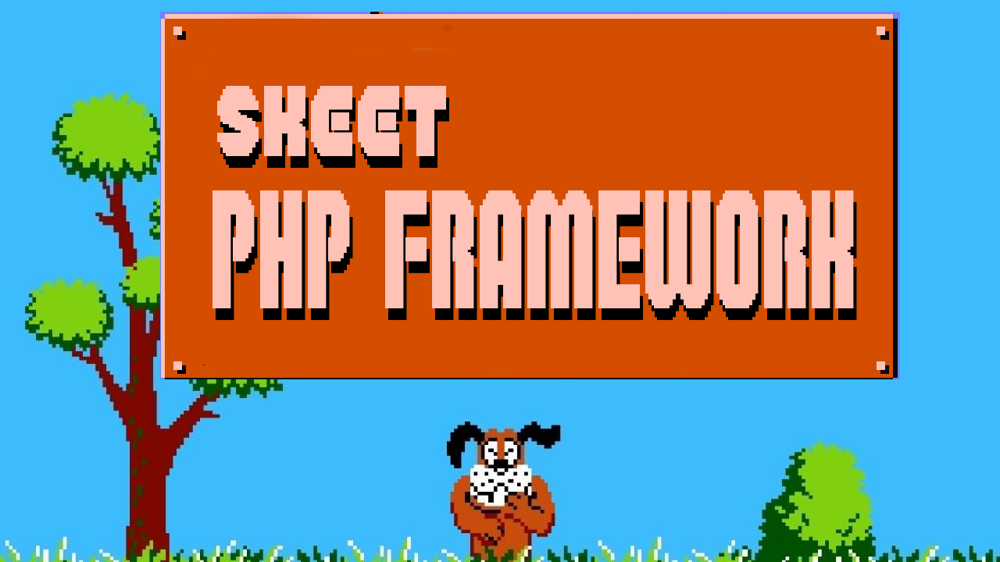

<p align="center"></p>

# Skeet

A small, fast PHP ORM + request-handling framework. Originally built for PHP 5.3;
this is the **PHP 8.x refresh** — typed throughout, PDO with prepared statements,
a schema-driven code generator, migrations, and a CLI.

Skeet is deliberately a **foundation, not a cathedral**. It gives you an ORM, a
database layer, a code generator, and a thin request/page model — then gets out
of your way. It does *not* try to be all things to all people, and it doesn't box
you into a giant query DSL or a pile of mandatory libraries.

---

## Philosophy (the "why")

A few opinions shape everything here; the full record is in
[`docs/design-decisions.md`](docs/design-decisions.md) (ADR-style, DD-001…).

- **SQL-first (DD-014).** The ORM handles the straightforward CRUD and the
  standard one-to-many / many-to-many relationships. For anything non-trivial you
  *write SQL* and hydrate it into model objects — no fighting a query builder that
  can't quite express what you want. `doQuery(sql, params)` and `Expr` are
  first-class, and everything is parameterized, so raw SQL stays safe.
- **Modernize, don't reimagine (DD-005).** The refresh kept Skeet's concepts
  (models, collections, factories, pages, the generator) and rebuilt the internals
  for PHP 8 — types, enums, property hooks, PDO. It is *not* a rewrite around a DI
  container or PSR-7 pipeline; the factory/service-locator style is a deliberate,
  comfortable choice, not a thing to apologize for.
- **Generate the boilerplate.** Point Skeet at a database and it emits typed model,
  collection, and factory classes (and, opt-in, CRUD pages) from your schema —
  regenerate any time; your hand-written subclasses are never clobbered.
- **Conventions, lightly.** `snake_case` tables → `StudlyCaps` classes; a `foo_id`
  column whose `foo` is a table is a belongs-to; an `a2b` table is a many-to-many;
  a `<table>_name` column is the display field; every table soft-deletes via a
  configurable column and keeps created/modified timestamps.
- **One Skeet, many apps.** A single Skeet install can power multiple applications
  that share models across namespaces (e.g. a user-facing app and a separate CRUD
  admin app).

## Requirements

- **PHP 8.1+** (the core targets the 8.1 floor; 8.4 unlocks property-hook model
  output — see [DD-009](docs/design-decisions.md)).
- **PDO**, plus the driver extension for your database: `pdo_sqlite`, `pdo_mysql`,
  `pdo_pgsql`, or `pdo_sqlsrv`.
- [Composer](https://getcomposer.org/) (for dev tooling / third-party libs; Skeet's
  own classes load via its bespoke autoloader, which coexists with Composer's —
  [DD-006](docs/design-decisions.md)).

## Install

```bash
composer require schiros/skeet      # as a dependency, or
git clone <repo> && cd skeet && composer install
```

## 60-second tour

```bash
# scaffold an app skeleton (SQLite by default)
php skeet/bin/skeet new ./myapp

# write a migration in ./myapp/migrations, e.g. 20260101_user.sql:
#   -- @up
#   CREATE TABLE "user" (id SERIAL PRIMARY KEY, user_name TEXT, is_retired INTEGER DEFAULT 0);
#   -- @down
#   DROP TABLE "user";

php skeet/bin/skeet migrate        --config=skeet.ini --path=./myapp/migrations
php skeet/bin/skeet generate:models --config=skeet.ini --namespace=MyApp --out=./myapp/generated
```

```php
// now use the generated model
$user = new \MyApp\Model\User(1);      // load by primary key
echo $user->getUserName();             // typed accessor
$user->setUserName('Ada');
$user->save();                         // UPDATE only the changed columns
$user->doSoftDelete();                   // sets is_retired = 1 (never a hard DELETE)

// relationships (generated from the schema)
foreach ($user->getOrdersCollection()->getCollection() as $order) { ... }

// SQL-first for anything beyond the standard cases
$db = \Skeet\DatabaseFactory::getDatabase();
$rows = $db->doQuery(
    'SELECT * FROM "user" WHERE user_name LIKE ? AND is_retired = 0',
    ['A%']
)->getResultAsArray();
```

## The CLI

```
php skeet/bin/skeet <command> [options]

  new <path>          scaffold an application skeleton
  migrate             apply pending migrations
  migrate:rollback    roll back the last migration(s)   (--steps=N)
  migrate:status      show which migrations are applied
  generate:models     generate model/collection/factory classes from the schema
  generate:crud       generate CRUD manage/list page classes for table(s)
  version             print the Skeet version

  common options: --env --config --db --path --namespace --php --out
```

## Docker (development)

```bash
docker compose up                      # SQLite (default), http://localhost:8080
docker compose --profile mysql up      # also start MySQL    (host: mysql)
docker compose --profile postgres up   # also start Postgres (host: postgres)
docker compose run --rm web vendor/bin/phpunit
```

Defaults to SQLite and PHP's built-in web server (a front-controller router is
included at `docker/router.php`). MySQL and Postgres are opt-in Compose profiles;
enable one and point your app's DB config at the `mysql` / `postgres` hostname.
Override `SKEET_DOCROOT` / `SKEET_PORT` / `APP_ENV` and the `MYSQL_*` / `POSTGRES_*`
credentials as needed.

## Testing

```bash
composer install
vendor/bin/phpunit
```

The suite is SQLite-backed and self-contained; a Postgres integration test runs
automatically when a Postgres server is reachable and skips otherwise.

## Documentation

- [Getting started](docs/getting-started.md) — build an app end to end.
- [Configuration](docs/configuration.md) — sources, env, secrets, all the keys.
- [Generator & CLI](docs/generator-and-cli.md) — conventions, output, commands.
- [Architecture](docs/architecture.md) · [Design decisions](docs/design-decisions.md)
  · [Findings](docs/findings.md) · [Roadmap](docs/roadmap.md)
- [`AGENTS.md`](AGENTS.md) — working guide for AI agents / contributors.

## License

BSD-2-Clause. © Matthew Schiros.
